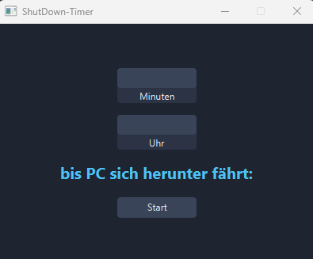
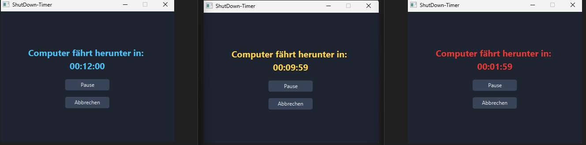

# ShutDown-Timer

Ein kleines JavaFX-Programm, das den Computer nach einer eingegebenen Zeit oder Uhrzeit herunterfährt.

Praktisch zum Beispiel, wenn du abends noch einen Film am Computer schaust und nicht noch einmal aufstehen möchtest, um den Computer manuell herunterzufahren.



## Funktionen

- **Zwei Eingabearten** (es darf immer nur eines der beiden Felder ausgefüllt sein):
  - **Minuten:** Der PC fährt nach X Minuten herunter (1 bis 1440 Minuten, also maximal 24 Stunden).
  - **Uhrzeit:** Der PC fährt zu einer bestimmten Uhrzeit herunter (Format `hh:mm`). Liegt die Uhrzeit bereits in der Vergangenheit, gilt sie für den nächsten Tag.
- **Live-Countdown:** Anzeige im Format `hh:mm:ss`, der sofort beim Start sichtbar ist.
- **Farbwechsel nach Restzeit:** Damit man die verbleibende Zeit auch aus der Ferne einschätzen kann:
  - Blau: mehr als 10 Minuten
  - Gelb: weniger als 10 Minuten
  - Rot: weniger als 2 Minuten



- **Pause und Fortsetzen:** Nur im Minuten-Modus möglich.
- **Abbrechen:** Jederzeit möglich.
- **Eingabeprüfung:** Fehlermeldung bei ungültigen Werten.
- **Dunkles Design:** Benutzeroberfläche mit dunklem Farbschema.

## Unterstützte Betriebssysteme

```text

| -- System | ------------------------ Befehl | --- Status |  
| - Windows | --- `shutdown -s -f -t 0`       | - Getestet |  
| --- Linux | ---- `systemctl poweroff`       | - Getestet |  
| --- macOS | -`osascript` (System Events)    | - Getestet |
```


Wird das Betriebssystem nicht erkannt, erscheint eine Fehlermeldung und es passiert nichts.

## Voraussetzungen

- Java Development Kit (JDK) mit JavaFX

## Starten

1. Projekt klonen oder herunterladen.
2. Projekt in einer IDE öffnen (z. B. Eclipse) und JavaFX einbinden.
3. `Main.java` ausführen.

## Bedienung

1. **Minuten** oder **Uhrzeit** (`hh:mm`) eintragen (nicht beides).
2. Auf **Start** klicken.
3. Der Countdown läuft. Mit **Pause** (nur im Minuten-Modus) oder **Abbrechen** lässt er sich steuern.

## Wichtige Hinweise

- **Alles vorher speichern!** Der Befehl enthält `-f` (erzwingt das Schließen). Programme werden ohne Rückfrage beendet. Nicht gespeicherte Arbeit geht verloren.
- Der Timer zählt Sekunden-Ticks. Geht der Rechner zwischendurch in den Ruhezustand, kann der Shutdown später als geplant erfolgen, besonders im Uhrzeit-Modus.
- Wird das Fenster geschlossen, läuft der Timer nicht weiter und es erfolgt kein Shutdown.

## Mögliche Erweiterungen

- [ ] Enter-Taste startet den Timer.
- [ ] Styles in eine CSS-Datei auslagern.
- [ ] Anzeige Uhrzeit wann Gerät herunter fährt.

## Technik

- Java
- JavaFX (`Timeline` für den Countdown, `VBox` für das Layout)
- `java.time` (`LocalTime`, `ChronoUnit`) für die Uhrzeitberechnung

